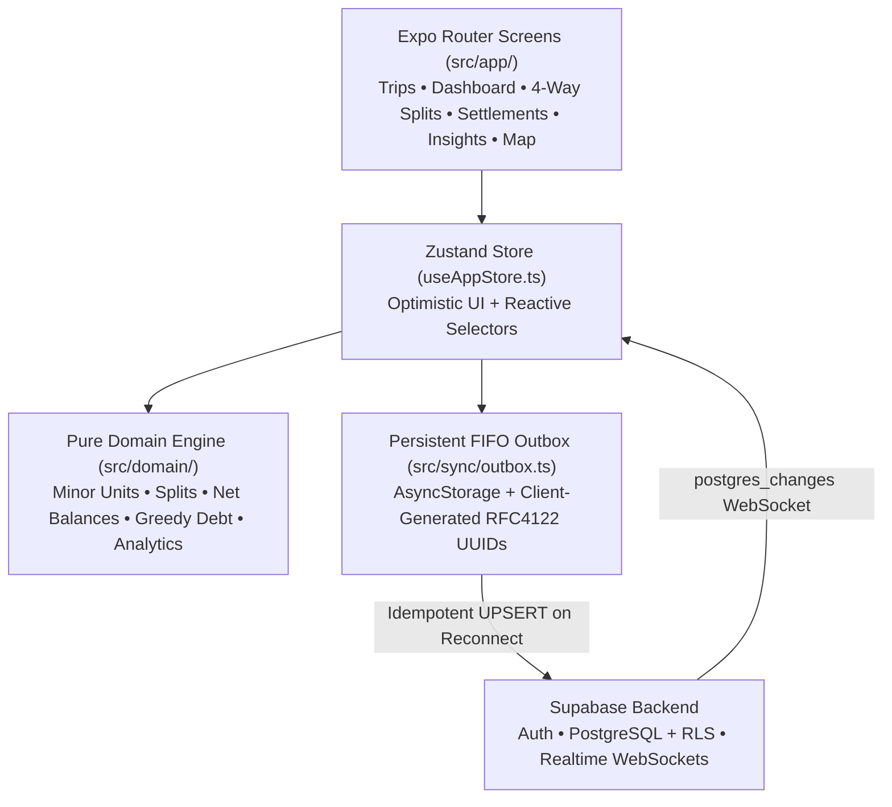

# TripSplit ✈️💸

**A collaborative, offline-first mobile app for splitting group travel expenses, tracking shared map pins, and minimizing settlement payments.**

Built with **React Native (Expo SDK 58)**, **TypeScript**, **Expo Router**, **Zustand**, and **Supabase (PostgreSQL + Row-Level Security + Realtime)**.

---

## ⚡ Try It in Under 60 Seconds (Recruiter Walkthrough)

No account creation or backend keys are required to evaluate the app:

1. Launch the app and tap **"Try 1-Tap Guest Demo"** on the login screen.
2. Explore the pre-loaded **"Tokyo & Kyoto 🇯🇵"** trip with 4 travelers (*Alex, Kenji, Sarah, Marcus*), expenses, and map pins.
3. Tap **Add** → try the **Quick-Add Helper** (e.g., `"Ramen 48.50 split between me and Kenji"`) or switch between **Equal, Exact, %, and Shares** splits to see remainder pennies distributed deterministically.
4. Tap **Settle Up** to inspect the **Simplified Settlement Plan** and record a 1-tap settlement payment.
5. Tap **Insights** for SVG category donut charts & member spend comparisons, or **Trip Map** to pin coordinates with GPS.
6. Go to **Trips → Join** and enter code **`PARIS26`** to join a second multi-currency (`EUR`) trip.
7. Go to **Profile → Simulate Airplane Mode**, add an expense while offline (`Offline • 1 queued`), then flip back online to watch the **FIFO Outbox** flush cleanly to `Synced`.

---

## 🏗️ System Architecture



---

## 🧠 Technical Decisions & Interview Talking Points

### 1. Precision Financial Math (Integer Minor Units)
* **Problem**: Floating-point arithmetic in JavaScript (`0.1 + 0.2 === 0.30000000000000004`) causes penny drift across splits and currency conversions.
* **Decision**: Store and compute every monetary value as **integer minor units** (e.g., cents, piastres, yen with currency-specific decimal scaling in `src/domain/money.ts`). Formatting to currency strings (`$14.99`) occurs strictly at the UI boundary.
* **Remainder Invariant**: Equal, Percentage, and Shares splits (using the **Largest Remainder / Hamilton-Hare method**) guarantee $\sum \text{splits} \equiv \text{totalMinor}$. Multi-currency conversions also reconcile rounding drift so $\sum \text{Net Balances} \equiv 0$.

### 2. Greedy Debt Simplification ($O(N \log N)$ vs. NP-Hard)
* **Problem**: In a group of $N$ travelers, naive expense tracking creates up to $N(N - 1) / 2$ messy back-and-forth payments and circular debts.
* **Decision**: Separate members into **creditors** ($\text{net} > 0$) and **debtors** ($\text{net} < 0$), sort descending, and greedily match the largest debtor with the largest creditor (`src/domain/debt.ts`).
* **Trade-Off**: Finding the absolute theoretical minimum number of transfers across arbitrary graphs reduces to the **NP-hard Subset Sum / Minimum Partition problem**. Greedy bipartite matching runs in $O(N \log N)$ time, guarantees **at most $N - 1$ transfers**, and yields optimal or near-optimal plans for real-world trip sizes.

### 3. Database-Enforced Multi-Tenancy (PostgreSQL RLS)
* **Decision**: Security is enforced inside PostgreSQL using **Row-Level Security (RLS)** on every table (`supabase/migrations/20260220_initial_schema.sql`), backed by a `SECURITY DEFINER` `is_trip_member(trip_id)` helper to avoid recursive policy checks.
* **Why**: Even if a client token is inspected or used directly against the REST API, the database engine refuses reads or writes for any trip the authenticated user does not belong to.

### 4. Offline-First FIFO Outbox & Idempotent Replay
* **Decision**: Every mutation receives a **client-generated RFC 4122 v4 UUID** and is persisted in a sequential FIFO queue (`src/sync/outbox.ts`) backed by `AsyncStorage` while the UI updates optimistically.
* **Why**: Replaying with client UUIDs via `UPSERT (onConflict: 'id')` makes retries **idempotent**—if connectivity drops mid-sync, replaying never creates duplicate expenses. Deletions use soft deletes (`deleted_at`) so offline removals sync cleanly across devices.

---

## 🛠️ Tech Stack

| Layer | Choice |
| --- | --- |
| **Framework** | React Native + Expo SDK 58 (TypeScript) |
| **Navigation** | Expo Router (Typed file-based routes) |
| **State Management** | Zustand |
| **Backend & Auth** | Supabase (PostgreSQL, Auth, Realtime, RLS) |
| **Token Storage** | `expo-secure-store` (Keychain / Keystore) |
| **Device APIs** | `expo-network`, `expo-location`, `expo-image-picker`, `expo-clipboard` |
| **Charts & QR** | `react-native-svg`, `react-native-qrcode-svg` |
| **Testing & Lint** | Jest, `jest-expo`, ESLint (`eslint-config-expo`), TypeScript strict |

---

## 🚀 Running Locally

### Prerequisites
* Node.js 20+ (`v22.23.1` tested)
* Expo Go app on iOS/Android, or an iOS Simulator / Android Emulator

### Setup
```bash
# 1. Install dependencies
npm install

# 2. (Optional) Configure Supabase for live multi-device sync
cp .env.example .env
# Fill in EXPO_PUBLIC_SUPABASE_URL and EXPO_PUBLIC_SUPABASE_ANON_KEY
# Apply supabase/migrations/20260220_initial_schema.sql in your Supabase SQL Editor

# 3. Start Expo dev server
npx expo start
```

### Verification Commands
```bash
npm test            # Run all unit tests (Domain math, splits, debt, analytics, quick-add, offline outbox)
npm run typecheck   # Strict TypeScript verification (tsc --noEmit)
npm run lint        # Expo ESLint verification
```
