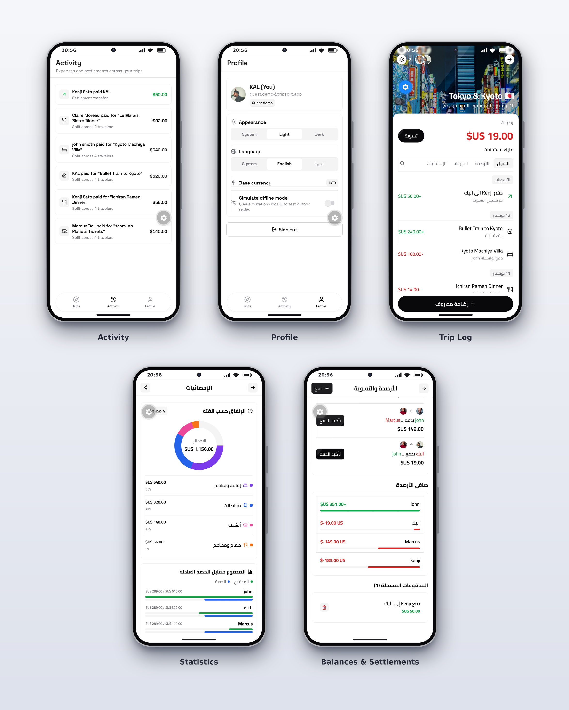
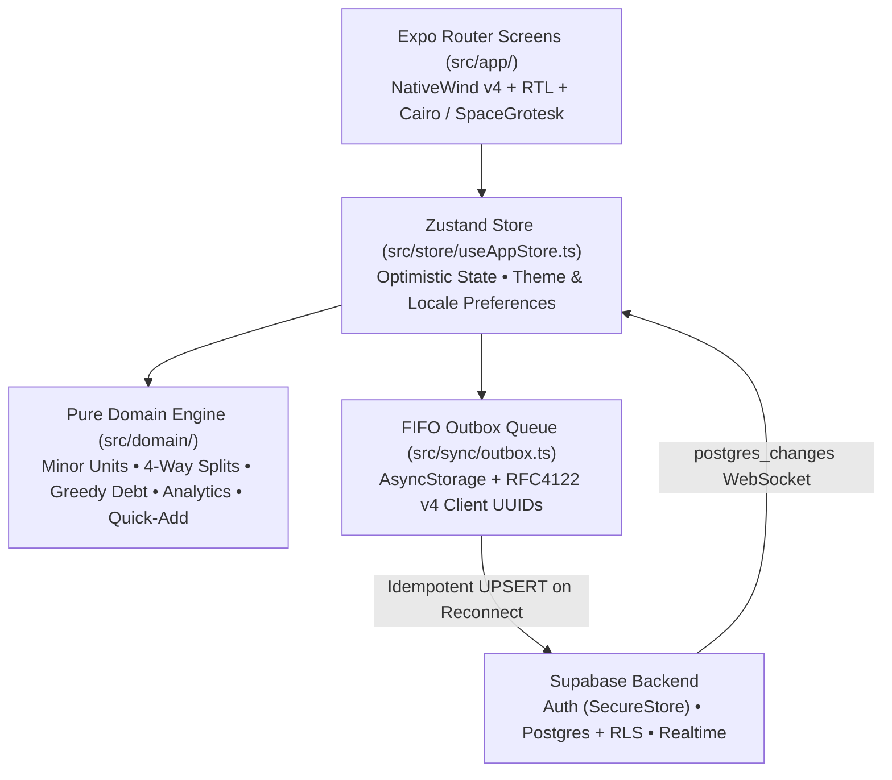

# TripSplit

**An offline-first mobile app for splitting group travel expenses, tracking trip spots, and minimizing group settlement transfers.**

Built with **React Native (Expo SDK 58)**, **TypeScript**, **Expo Router**, **NativeWind v4**, **Zustand**, **i18next**, and **Supabase (PostgreSQL + Row-Level Security + Realtime)**.

---

---
## Key Features

- **Pure Monochrome Design + Light/Dark Mode**: High-contrast monochrome UI built with NativeWind (`tailwindcss`), `SpaceGrotesk` typography with `tabular-nums`, floating pill bottom navigation, and persisted `System | Light | Dark` appearance preferences.
- **Full English & Arabic (`ar`) + RTL Support**: Powered by `i18next`, `react-i18next`, and `expo-localization` with dynamic RTL layout mirroring, Arabic plural rules, and `Cairo` optical font scaling.
- **Precision Group Expense Engine**: Integer minor-unit accounting with multi-currency FX conversion and 4 split modes (**Equal**, **Exact**, **Percent**, **Shares**) using Largest Remainder distribution.
- **Greedy Debt Simplification**: Reduces messy group IOUs to at most $N - 1$ simplified transfers in $O(N \log N)$ time.
- **Bilingual Quick-Add Parser**: Deterministic offline parser supporting English and Arabic inputs (including Eastern Arabic numerals `٠-٩`) to prefill title, amount, category, payer, and participants.
- **Trip Customization & Media**: Optional device camera/library cover photos and presets, receipt photo attachments, QR code invite passes (`tripsplit://join/<code>`), and full trip settings/deletion.
- **Insights & Trip Map**: Reserved color analytics strictly on the Insights tab (category donut chart, paid vs. fair-share bars, daily spend timeline) and coordinate GPS spot pinning with Apple/Google Maps links.
- **Offline-First Outbox Sync**: Sequential `AsyncStorage` mutation queue with client-generated RFC 4122 v4 UUIDs and idempotent Supabase replay.

---

## Try the Built-In Demo (No Backend Required)

You can evaluate the entire app immediately without creating an account or configuring Supabase:

1. Launch the app and tap **"Try Offline Demo (Tokyo Trip)"** on the login screen.
2. Open **Tokyo & Kyoto** to browse the grouped ledger, or tap **Log Expense** to test **Quick add** (e.g., `"Ramen dinner 48.50 split between me and Kenji"` or `"عشاء بحري ٢٤٠ بيني وبين سارة"`) and the 4 split modes.
3. Tap **Settle** or **Balances** to review **Recommended transfers** and record a settlement with **Mark paid**.
4. Switch to **Insights** for category and member breakdowns, or **Map** to pin GPS coordinates.
5. Tap the **Settings** gear in the trip header to rename the trip, attach/change its cover photo, or delete it.
6. On the **Trips** tab, tap the QR button and enter code **`PARIS26`** to join a second sample trip in `EUR`.
7. Open **Profile** to switch **Appearance (`System | Light | Dark`)**, toggle **Language (`System | English | العربية`)**, or enable **Simulate offline mode** to queue mutations and watch them sync.

---

## Architecture



### Technical Highlights
- **Integer Minor-Unit Accounting (`src/domain/money.ts`, `src/domain/splits.ts`)**: All balances and splits are computed in integer minor units (cents, piastres, yen) with currency-aware decimals (`0`, `2`, or `3` for KWD), avoiding IEEE-754 float drift and preserving $\sum \text{splits} \equiv \text{totalMinor}$.
- **Minimum-Transfer Settlement (`src/domain/debt.ts`)**: Separates creditors and debtors and greedily matches largest balances in $O(N \log N)$ time, guaranteeing $\le N - 1$ transfers.
- **Database-Enforced Multi-Tenancy (`supabase/migrations/20260220_initial_schema.sql`)**: PostgreSQL Row-Level Security (RLS) policies on every table restrict reads and writes to members of each trip.
- **Idempotent Offline Replay (`src/sync/outbox.ts`, `src/sync/tripSync.ts`)**: Mutations receive client-generated UUIDs so retrying failed requests via `UPSERT (onConflict: 'id')` never duplicates records.

---

## Project Structure

```text
├── __tests__/               # Unit tests (domain math, quick-add, i18n, outbox)
├── assets/                  # App icons & splash assets
├── src/
│   ├── app/                 # Expo Router file-based screens & layouts
│   │   ├── (auth)/          # Login / Sign-up / Guest demo
│   │   ├── (tabs)/          # Trips, Activity, Profile tabs
│   │   ├── join/[code].tsx  # Deep link join handler
│   │   └── trip/            # New/Join trip modals & Trip Dashboard, Balances, Map, Insights, Settings
│   ├── components/          # Reusable NativeWind UI primitives, navigation, & trip components
│   ├── constants/           # Monochrome palette, category metadata, SpaceGrotesk + Cairo typography
│   ├── domain/              # Pure TypeScript financial & parsing logic
│   ├── hooks/               # useTheme & useLocale
│   ├── i18n/                # i18next config + en/ar translation dictionaries
│   ├── lib/                 # Supabase SecureStore adapter & NativeWind cssInterop setup
│   ├── store/               # Zustand app store
│   ├── sync/                # Offline outbox & Supabase sync engine
│   └── types/               # Generated Supabase database types
└── supabase/migrations/     # Initial PostgreSQL schema & RLS policies
```

---

## Tech Stack

| Layer | Technology |
| --- | --- |
| **Framework** | React Native `0.88` + Expo SDK `58` + TypeScript |
| **Routing** | Expo Router (typed routes) |
| **Styling** | NativeWind v4 (`tailwindcss` `3.4`) |
| **State Management** | Zustand |
| **Localization** | `i18next`, `react-i18next`, `expo-localization` (`en` / `ar` + RTL) |
| **Typography** | `SpaceGrotesk` (Latin/tabular numbers) + `Cairo` (Arabic) |
| **Backend & Auth** | Supabase (PostgreSQL, Auth, RLS, Realtime) + `expo-secure-store` |
| **Device & Media** | `expo-image-picker`, `expo-location`, `expo-network`, `expo-clipboard` |
| **Visuals & Charts** | `lucide-react-native`, `react-native-svg`, `react-native-qrcode-svg` |
| **Testing & Lint** | Jest, `jest-expo`, ESLint (`eslint-config-expo`), `tsc --noEmit` |

---

## Getting Started

### Prerequisites
- **Node.js 20+**
- **Expo Go** on iOS/Android, a local simulator/emulator, or a development build

> **Note on RTL testing:** Web updates layout direction immediately on language switch. On iOS/Android, dynamic `I18nManager` OS navigation transitions require a development build (`npx expo run:android` / `npx expo run:ios` or `eas build --profile development`), whereas standard Expo Go resets native RTL flags across reloads.

### Setup & Run

```bash
# 1. Install dependencies
npm install

# 2. (Optional) Configure Supabase for live multi-user sync
cp .env.example .env
# Populate EXPO_PUBLIC_SUPABASE_URL and EXPO_PUBLIC_SUPABASE_ANON_KEY in .env
# Run supabase/migrations/20260220_initial_schema.sql in your Supabase SQL Editor

# 3. Start the Expo development server
npx expo start --clear
```

### Verification Commands

```bash
npm run typecheck   # Strict TypeScript check (tsc --noEmit)
npm run lint        # Expo ESLint check
npm test            # Jest unit test suite (domain, i18n, outbox)
```

---

## License

This project is licensed under the MIT License — see [LICENSE](LICENSE) for details.
